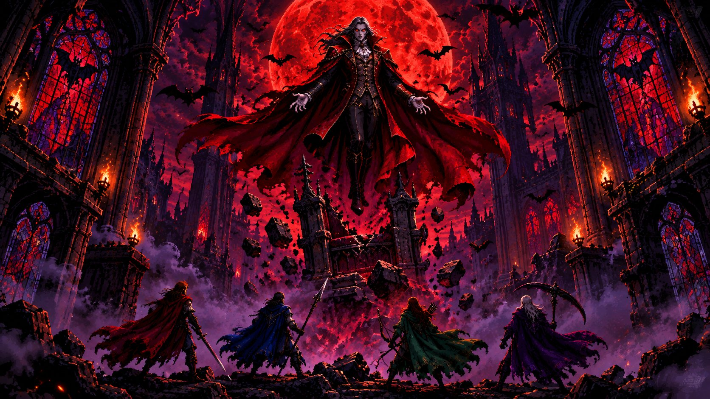
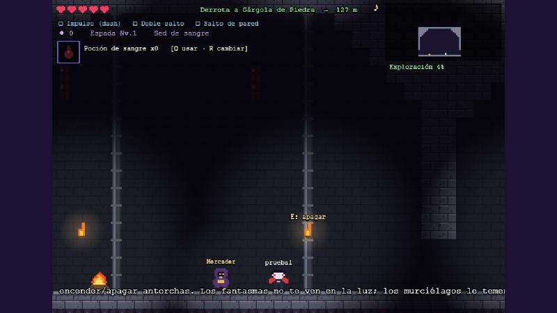
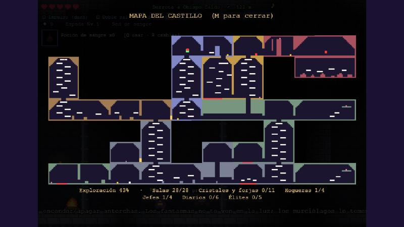
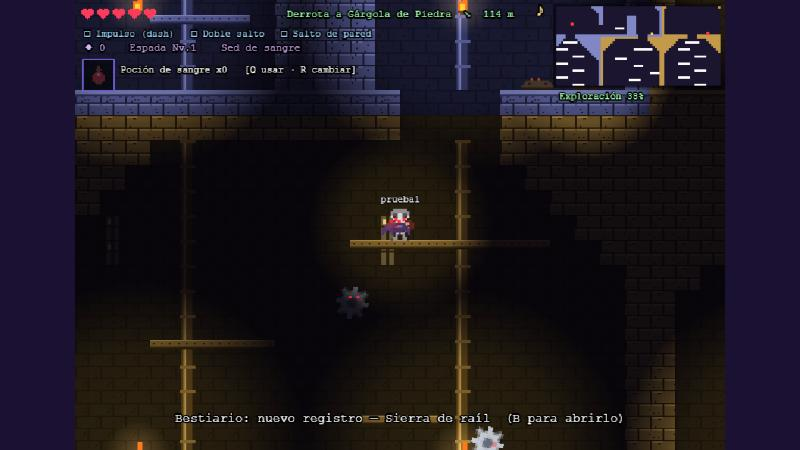
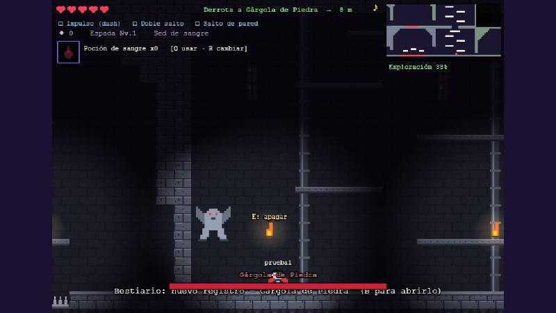
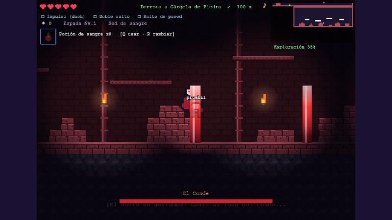

<div align="center">



# Four Fangs of Dawn

**Metroidvania gótico cooperativo online para 1-4 jugadores, en pixel art, directamente en el navegador.**


*Four vampire hunters, one cursed castle, one blood-red moon. A co-op metroidvania that runs in any browser.*

</div>

---

## Qué es

Cuatro cazadores vampiro irrumpen en el castillo del Conde. Exploras un mapa conectado de más de 25 zonas, derrotas a cuatro jefes que te entregan nuevas habilidades y vuelves sobre tus pasos para abrir atajos y secretos. Se puede jugar en solitario o con hasta **tres amigos más**, cada uno desde su navegador (PC, móvil, tele con navegador o con mando).

| | |
|---|---|
|  |  |
|  |  |
|  | |

## Características

- **Cooperativo online** con salas de 4 letras, entrada en caliente a partidas empezadas y migración del anfitrión.
- **Cuatro vampiros**, cada uno con arma, pasiva y desventaja propias:

  | Vampiro | Arma | Pasiva | Desventaja |
  |---|---|---|---|
  | Carmesí | Espada | Sed de sangre: cura el 40 % de los golpes | — |
  | Azul | Lanza (largo alcance) | Visión nocturna | Más daño de los proyectiles |
  | Esmeralda | Arco | Cazadora de almas (+50 % de almas) | +50 % de daño recibido y no rompe muros sin bombas |
  | Violeta | Guadaña | Piel de sombra (+2 corazones) | Se mueve más lento (lo compensa con un **gancho automático** al borde si el salto se queda corto) |

- **Metroidvania de verdad:** Impulso, Doble salto y Salto de pared abren zonas y atajos nuevos. Cada vampiro conquista sus propios poderes y tiene su propia partida guardada.
- **Oscuridad y luz como mecánica:** las antorchas se encienden y apagan (`E`) y su estado se comparte. Los fantasmas no ven a quien está bajo la luz, los murciélagos huyen de ella y el Guardián del Reloj es invulnerable mientras haya luz.
- **Jefes con mecánicas propias**, incluida la pelea final, donde el suelo del trono se derrumba y todos caen a un foso con escombros.
- **Las Torres del Alba (tras el Conde):** al caer, el Conde huye y derriba los muros del foso. Arriba esperan dos hermanos rivales, **Aurora** y **Vesper**: solo puedes derrotar a uno, porque al caer el otro lo rescata y huye. Cada uno da una habilidad distinta (**Alas del Alba**: planear, u **Ojo de la Noche**: ver los secretos tras los muros agrietados). Un oráculo explica la elección antes de decidir. Al vencer a uno se abre el camino al cielo: una zona **sin jefes** (Cumbre del Alba, Jardín Colgante y Mazmorra de Nubes) hecha para explorar con todas las habilidades. Quien eligió a Aurora puede planear sobre los pinchos largos de la Cripta Olvidada y hasta un balcón lejano; quien eligió a Vesper ve la alcoba secreta de la Cumbre con dos cristales de vida.
- **La Cueva del Abismo (secreto de las Alas del Alba):** al final de los pinchos largos de la Cripta Olvidada hay un hueco que da paso a una caída libre por una cueva de lava. Abajo trabaja el **Herrero de la Cueva**, que imbuye tu arma con un poder elemental (Fuego, Hielo, Rayo o Veneno) con un menú que explica cada elección y cambia el color del ataque. Si le llevas el **Martillo Latente** (lo guarda la Reina de Huesos en las Catacumbas) se muda a un santuario secreto bajo la Cumbre del Alba y ofrece también los poderes de sombra (Sombra, Eclipse y Marchitar).
- **Plataformas que aparecen y desaparecen:** la zona rosa (Torres del Alba) tiene puzles de tiempo: escalones que parpadean antes de desaparecer y que hay que cruzar con buen ritmo para llegar a cristales y gemas.
- **Enemigos con nombre con habilidades propias:** por ejemplo, el Relojero Oxidado deja un rastro de veneno de 3 segundos y lanza nubes que se quedan 5 segundos en el aire.
- **Enemigos invulnerables** (sierras de raíl y centinelas), enemigos que se endurecen por zona y **élites con nombre**: no retroceden al ser golpeados, tienen una habilidad propia (carga, orbes, terremoto, teletransporte con soplido que apaga antorchas, furia) y recompensa fija.
- **Salas secretas de verdad:** lo que hay tras un muro agrietado no se ve (ni en el mapa ni por su brillo) hasta romperlo.
- **Dos monedas:** las **almas** (◆) se ganan matando enemigos y compran objetos corrientes; las **gemas** (✦) se encuentran por el mapa y las sueltan jefes y élites, y compran mejoras permanentes (Colmillo de acero, Talismán de almas), el Fruto de sangre y el Amuleto. Los mercaderes amplían su mercancía según avanzas.
- **Acto II antes del Conde:** dos segmentos con jefe, el **Archivo Prohibido** (Archimago Silente) y las **Catacumbas Reales** (Reina de Huesos). Sus sellos abren la puerta de la Sala del Trono.
- **Viaje rápido temprano:** la Gran Hoguera de la Capilla lo desbloquea; al descansar en cualquier hoguera encendida eliges a cuál viajar.
- **Progreso con sentido:** guardado solo al descansar en hogueras, porcentaje de exploración, bestiario y diarios de historia.
- **Todo el arte y la música se generan por código:** sprites y tiles en pixel art dibujados a partir de mapas de texto y una banda sonora procedural con WebAudio.
- **Pensado para cualquier pantalla:** teclado, **mando de PlayStation/estándar**, **controles táctiles** con cruceta de arrastre y un **modo ligero** para televisores y dispositivos lentos.

## Controles

| Acción | Teclado | Mando | Móvil |
|---|---|---|---|
| Mover | Flechas / A D | Cruceta / stick | Cruceta de arrastre |
| Saltar (mantener en el aire: planear con las Alas del Alba) | ↑ / W / Espacio | ✕ | ▲ de la cruceta |
| Agacharse / bajar de plataforma | ↓ / S (+ saltar) | Cruceta ↓ | ▼ de la cruceta |
| Atacar | X / J | ◻ | ⚔ |
| Impulso | C / K / Shift | ○ | » |
| Interactuar (hogueras, antorchas, NPC) | E | △ | E |
| Usar / cambiar objeto | Q / R | R1 / L1 | 🧪 / ⟳ |
| Mapa · Bestiario y diarios | M · B | Options · R3 | 🗺 · 📖 |
| Silenciar música | N | — | ♪ |

## Empezar

Requisitos: **Node.js 20 o superior**.

```bash
git clone https://github.com/txaberOcio/four-fangs-of-dawn.git
cd four-fangs-of-dawn
npm install
npm start
```

Abre `http://localhost:3000`, regístrate con un usuario y una contraseña, crea una sala y comparte el código de 4 letras.

En **Windows** también puedes hacer doble clic en `Iniciar-servidor.bat`: instala Node si falta (con `winget`), instala las dependencias y abre el juego.

### Instalador para Windows (sin instalar Node)

**Descarga directa (Windows):** [FourFangsOfDawn-Setup.exe](https://github.com/txaberOcio/four-fangs-of-dawn/releases/download/v0.1.0-alpha/FourFangsOfDawn-Setup.exe) · [todas las versiones](https://github.com/txaberOcio/four-fangs-of-dawn/releases)

Si alguien solo quiere probar el juego, puedes darle **`FourFangsOfDawn-Setup.exe`**: lo instala en su carpeta de usuario (sin permisos de administrador), crea accesos directos en el escritorio y en el menú Inicio y abre el juego en el navegador. Para jugar con amigos en la misma red, el que ejecuta el juego comparte la dirección `http://IP:3000` que muestra su ventana. Sus partidas se guardan en `%APPDATA%\FourFangsOfDawn`. Windows puede avisar de que el programa no está firmado: pulsa *Más información → Ejecutar de todos modos*.

Se genera con `npm run build:exe` (salida en `dist/`), ver [docs/DESARROLLO.md](docs/DESARROLLO.md).

### Jugar con amigos en la red local

1. Arranca el servidor en tu equipo. La consola muestra una línea **«En la red local»** con una dirección como `http://192.168.1.128:3000`.
2. Los demás abren esa dirección desde un navegador de la misma red. Si Windows pregunta por el cortafuegos, permite el acceso en redes privadas.
3. Para jugar por internet hay que exponer el puerto (por ejemplo con un túnel) o desplegarlo en un servidor propio.

> En televisores o dispositivos lentos añade `?lite=1` a la dirección (o marca *Modo ligero* en el menú).

## Scripts

| Comando | Qué hace |
|---|---|
| `npm start` | Arranca el servidor en el puerto 3000 (`PORT` lo cambia) |
| `npm run check` | Comprueba la sintaxis de todos los ficheros |
| `npm run validate` | Simula la física del jugador sobre el mapa y comprueba que todo el castillo se puede completar en orden |

## Estructura

```
server/index.js    Servidor: cuentas, salas, relé de estado, guardado de partidas
public/            Cliente (Phaser 3)
  world.js         Definición del mundo: áreas, puertas, enemigos, objetos (compartido con el validador)
  game.js          Escena principal: jugador, enemigos, jefes, luz, mapa
  extras.js        Armas, tienda, diálogos, bestiario, controles táctiles y mando
  art.js           Arte en pixel art generado por código
  music.js         Música procedural (WebAudio)
scripts/validate.js  Validador de alcanzabilidad del mapa
docs/              Documentación y capturas
```

Guía para preparar el entorno (Node, Git, VS Code) en [`docs/DESARROLLO.md`](docs/DESARROLLO.md). Más detalle técnico en [`docs/ARCHITECTURE.md`](docs/ARCHITECTURE.md).

## Hoja de ruta

- Subir de nivel en las hogueras (vitalidad, fuerza, velocidad).
- Nueva partida+ con enemigos más duros y aspectos nuevos.
- Más zonas, jefes y atajos (el castillo seguirá creciendo hacia el cielo).
- Panel de opciones (volumen, tamaño de texto, daltonismo, reasignar teclas).

## Créditos y licencia

- Código distribuido bajo licencia [MIT](LICENSE).
- Sprites, tiles y música generados por código dentro del propio proyecto.
- La ilustración de portada se ha creado con herramientas de IA generativa.
- Motor: [Phaser](https://phaser.io) · Red en tiempo real: [Socket.IO](https://socket.io).
