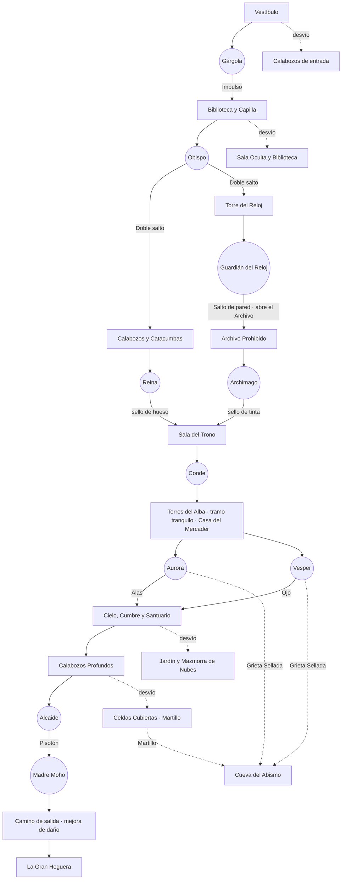

# Zona 1: recorrido, desbloqueos y dificultad

*Estado del mapa a 24/10/2026, tras el reequilibrio.* «Zona 1» es **todo el mapa actual**: del Vestíbulo hasta La Gran Hoguera. Dentro de ella hablamos de **regiones** (Vestíbulo, Biblioteca, Capilla, Calabozos…), para no confundirlas con las «zonas» de paleta del código (`z` en `world.js`).

Este documento define el **recorrido previsto**, qué abre cada jefe, qué desvíos hay y las reglas de dificultad. Los datos salen del propio mapa: el informe [RECORRIDO-ZONA1.md](RECORRIDO-ZONA1.md) se regenera con `npm run recorrido` y `npm run validate` comprueba que el orden de jefes sigue siendo este (`World.PROGRESSION`).

## 1. El recorrido en una tabla

| Etapa | Jefe | Lo que da | Lo que abre | Regiones nuevas en el camino | Desvíos que se abren |
|---|---|---|---|---|---|
| 0 | **Gárgola de Piedra** (Cubil) | Impulso | La subida del Gran Salón (exige Impulso) → Escalera de los Retratos → Biblioteca y Capilla | Vestíbulo | Calabozos de entrada: Túnel, Bodega, Cripta Olvidada, Osario (gema; su cristal exige Doble salto), Pozo de las Almas. Grieta Sellada (bajo la Bodega, con la puerta cerrada) |
| 1 | **Obispo Caído** (Ábside) | Doble salto | La reja de las Cadenas (a los Calabozos), la subida del Pozo, el paso del Mirador a la Galería de Engranajes (Torre del Reloj) | Escalera de los Retratos, Archivo, Capilla | Sala Oculta (cristal y gema). Biblioteca: Sala de Lectura (gema), Gran Biblioteca (mejora de arma: alcance, no daño; élite) y Observatorio (gema) |
| 2 | **Reina de Huesos** y **Guardián del Reloj**, en cualquier orden | Reina: sello de hueso. Reloj: Salto de pared | Reloj: la puerta del Archivo Prohibido. Salto de pared: los muros del Pasillo Real | Calabozos y Catacumbas; Torre del Reloj | — |
| 3 | **Archimago Silente** (Scriptorium), jefe temible | Sello de tinta | Con los dos sellos, la puerta de la Sala del Trono | Archivo Prohibido | — |
| 4 | **El Conde** (Sala del Trono) | — | El foso del Conde → Torres del Alba. Abre también el suelo agrietado de la Cumbre (para más adelante) | Sala Real | — |
| 5 | **Aurora o Vesper** (solo uno) | Alas del Alba u Ojo de la Noche | La puerta al cielo y la puerta de la Grieta Sellada (Cueva del Abismo) | Torres del Alba: **tramo tranquilo** (sin enemigos, música de calma) con la **Casa del Mercader** | — |
| 6 | **Alcaide Verdín** (Sala del Alcaide) | Pisotón de Raíces | La tapa de raíces hacia la Madre Moho; las losas de la Veta de Ceniza | Cielo, Cumbre, Santuario y Calabozos Profundos (mercader en el Pozo del Ascensor) | Jardín Colgante (gema), Mazmorra de Nubes (cristal y gema), Celdas Cubiertas (cristal y élite con el **Martillo Latente**), Cueva del Abismo por la Grieta Sellada (Herrero, Forja de los Elementos, gema) |
| 7 | **La Madre Moho** (Corazón del Musgo) | — | La puerta oeste: el camino de salida | — | — |
| 8 | *(fin)* **La Gran Hoguera** | **Mejora de daño de la Zona 1** (Antesala del Abismo) | Se llega cayendo: no hay vuelta por ahí | Camino de salida (5 salas, hoguera en la Veta de Ceniza) | — |

## 2. Camino principal sala a sala

Ruta más corta (en salas) de un jefe al siguiente. ✦ = sala que se abre en esa etapa.

- **0.** Vestíbulo ✦ → Gran Salón ✦ → Corredor de Armaduras ✦ → Foso de Espinas ✦ → Cubil de la Gárgola ✦
- **1.** Cubil → Foso → Corredor → Gran Salón → Escalera de los Retratos ✦ → Archivo ✦ → Nave Sur ✦ → Nave Principal ✦ → Ábside ✦
- **2a (Reloj).** Ábside → Mirador → Galería de Engranajes ✦ → Torre del Reloj ✦ → Cámara del Reloj ✦
- **2b (Reina).** Ábside → Nave Principal → Nave Sur → Pasaje de Cadenas → Calabozo Norte ✦ → Mazmorra de Hierro ✦ → Galería de Huesos ✦ → Cripta de la Reina ✦
- **3.** Cámara del Reloj → … → Gran Biblioteca → Observatorio → Salón de los Atriles ✦ → Pasaje de Tinta ✦ → Escalera de Pergaminos ✦ → Scriptorium ✦
- **4.** Del Scriptorium vuelta por la Biblioteca y la Torre del Reloj → Pasillo Real → Sala del Trono ✦ (con viaje rápido se ahorra casi todo).
- **5.** Trono → Pasillo Real → Escalera Real ✦ → Foso del Conde ✦ → Torre del Alba ✦ → Sala de los Rivales ✦ (Casa del Mercader) → Cámara de Aurora ✦ o de Vesper ✦. **Todo el tramo sin enemigos.**
- **6.** Cámara de Vesper → Antecámara del Cielo ✦ → Escalera al Cielo ✦ → Cumbre del Alba ✦ → (suelo agrietado) Santuario ✦ → (ascensor) Pozo del Ascensor ✦ → Galería de Raíces ✦ → Cisterna de Musgo ✦ → Refectorio Podrido ✦ → Pasaje de Zarzas ✦ → Antesala del Alcaide ✦ → Sala del Alcaide ✦
- **7.** Sala del Alcaide → (tapa de raíces) Corazón del Musgo ✦
- **8.** Corazón del Musgo → Raíces de Salida ✦ → Galería de Zarzas ✦ → Veta de Ceniza ✦ (hoguera) → Sala de Brasas ✦ → Antesala del Abismo ✦ (mejora de daño) → (caída) La Gran Hoguera

## 3. Desvíos y qué dan

| Desvío | Se abre en | Qué tiene |
|---|---|---|
| Túnel de Calaveras, Bodega, Pozo de las Almas | Etapa 0 | Enemigos; el Pozo lleva a los Calabozos más tarde (Doble salto) |
| Cripta Olvidada | Etapa 0 | Con Alas, el hueco de los pinchos a la Cueva del Abismo |
| Osario | Etapa 0 | Gema; su cristal exige Doble salto |
| Grieta Sellada | Etapa 0 (se ve), etapa 6 (se abre) | Puerta a la Caída Libre que se abre al caer Aurora o Vesper |
| Sala Oculta | Etapa 1 (muro agrietado) | Cristal de vida, gema |
| Sala de Lectura, Gran Biblioteca, Observatorio | Etapa 1 (camino en la 3) | Mejora de arma (alcance), élite Bibliotecario Maldito, 2 gemas |
| Mirador | Etapa 1 (camino en la 2) | Hoguera (el mercader se ha mudado a la Casa del Mercader) |
| Pasaje de Cadenas | Etapa 1 (camino en la 2) | Élite Carcelero, diario |
| Jardín Colgante | Etapa 6 | Gema |
| Mazmorra de Nubes | Etapa 6 | Cristal de vida, gema |
| Celdas Cubiertas | Etapa 6 | Cristal de vida, élite Verdugo Cubierto de Musgo, que suelta el **Martillo Latente** |
| Cueva del Abismo (Caída Libre, Forja, Gran Hoguera) | Etapa 6 (con los dos rivales) | Herrero (poderes elementales; con el Martillo se muda al Santuario y ofrece también los de sombra), gema |

Solo hay dos elecciones de orden: en la **etapa 2** (Reina o Reloj primero) y en la **etapa 5** (Aurora o Vesper, excluyentes).

## 4. Reglas de dificultad

- **Daño:** una sola mejora de daño por zona, en las salas finales de esa zona. En la Zona 1 está en la Antesala del Abismo (espada de 1 a 2 de daño, nivel de arma 3). La mejora de la Gran Biblioteca da alcance y velocidad, no daño. El Colmillo de acero no se vende en la Zona 1. Así **toda la Zona 1 se juega con 1 de daño** (la Guadaña, con 2) y la vida de los jefes son los golpes que hacen falta.
- **Corazones:** 5 de base, 8 cristales en el mapa (uno de los de la Cumbre es solo para Aurora) y 2 Frutos de sangre como mucho (5 y 7 gemas, en la Casa del Mercader). Máximo de la zona: 15.
- **Gemas:** 16 en el mapa, 24 de los jefes y 1 por élite: unas 47 en toda la zona. Sirven para Frutos, Talismanes, Amuletos y poderes de la forja.
- **Enemigos:** su vida sube despacio por zona: ×1 (Vestíbulo) → ×1,1 (Biblioteca y Capilla) → ×1,25 (Calabozos, Torre del Reloj, Archivo Prohibido) → ×1,4 (Sala Real) → ×1,5 (Torres del Alba y camino de salida) → ×1,6 (Cueva del Abismo) → ×1,7 (Calabozos Profundos). Desde la zona 4 pegan 1 más. Los élites tienen el triple de vida. En cooperativo, ×1,3 / ×1,6 / ×1,9.
- **Tramos tranquilos:** sin enemigos y con música de calma (marca `['calm']` en `world.js`). Ahora: Escalera Real, Foso del Conde, Torre del Alba, Sala de los Rivales y la Casa del Mercader.
- **Tiendas:** Vestíbulo (básico), Nave Sur (Capilla), Casa del Mercader (tras el Conde) y Pozo del Ascensor (Calabozos Profundos). Cada una enseña lo que tendrá cuando caigan más jefes.

| Etapa | Jefe | Vida (= golpes con 1 de daño) | Vida de enemigos en el camino | Corazones máx. al empezar la etapa |
|---|---|---|---|---|
| 0 | Gárgola | 12 | 49 | 5 |
| 1 | Obispo | 16 | 80 | 6 |
| 2 | Reina · Reloj | 20 · 22 | 131 | 8 |
| 3 | Archimago (temible) | 30 | 151 | 8 |
| 4 | Conde | 32 | 151 (vuelta) | 8 |
| 5 | Aurora / Vesper | 34 | 0 (tramo tranquilo) | 10 |
| 6 | Alcaide | 36 | 163 | 15 |
| 7 | Madre Moho | 40 | 0 | 15 |
| 8 | *(camino de salida)* | — | 231, con hoguera a mitad | 15 |

### Qué se ha corregido (24/10/2026)

1. **El poder del jugador ya no se dispara pronto:** sin Colmillos, la mejora de daño solo al final y menos cristales al principio (antes 10 corazones en la etapa 2; ahora 8).
2. **Gemas:** de unas 72 a unas 47, y el Fruto de sangre tiene límite (2).
3. **Vida de los jefes en orden:** 12 → 16 → 20/22 → 30 → 32 → 34 → 36 → 40. El Archimago sigue siendo un pico en su etapa, pero el Conde cierra el acto por encima.
4. **Camino de salida:** de 439 a 231 de vida de enemigos, con hoguera en la Veta de Ceniza.
5. **Etapas vacías:** la 5 es ahora un tramo tranquilo a propósito (música de calma); la 7 sigue siendo solo la sala de la Madre.
6. **Aurora y Vesper:** los dos abren la Cueva del Abismo en la etapa 6 (por la Grieta Sellada).
7. **Martillo Latente:** lo suelta el Verdugo Cubierto de Musgo (Celdas Cubiertas).
8. **Tiendas:** el mercader del Mirador se ha mudado a la Casa del Mercader y hay uno nuevo en el Pozo del Ascensor.
9. **Desvíos tempranos:** la Cripta y el Observatorio ya no dan cristal.

### Pendiente de probar jugando

- Que 30–40 golpes por jefe no se hagan largos, sobre todo con la Madre Moho (solo se le hace daño tras romper la armadura con el Pisotón).
- Que 8 corazones basten para el Archimago y el Conde.
- Las partidas guardadas de antes conservan lo que ya tenían (nivel de arma, Colmillos, corazones).

## 5. Cómo mantener esto al día

- `npm run validate` falla si cambia el orden de jefes de `World.PROGRESSION` (`public/world.js`).
- `npm run recorrido` vuelve a generar [RECORRIDO-ZONA1.md](RECORRIDO-ZONA1.md): etapas, camino sala a sala, desvíos, poder del jugador y vida de enemigos.
- Para cambiar el orden: tocar las puertas del mapa (subidas que exigen habilidad, puertas por jefe, losas de Pisotón) y la tabla `PROGRESSION`; el validador dirá si cuadra.
- Para una zona nueva: una mejora de daño en sus salas finales, sus tiendas en los tramos tranquilos y la vida de sus jefes pensada para el daño que se tiene al llegar.
